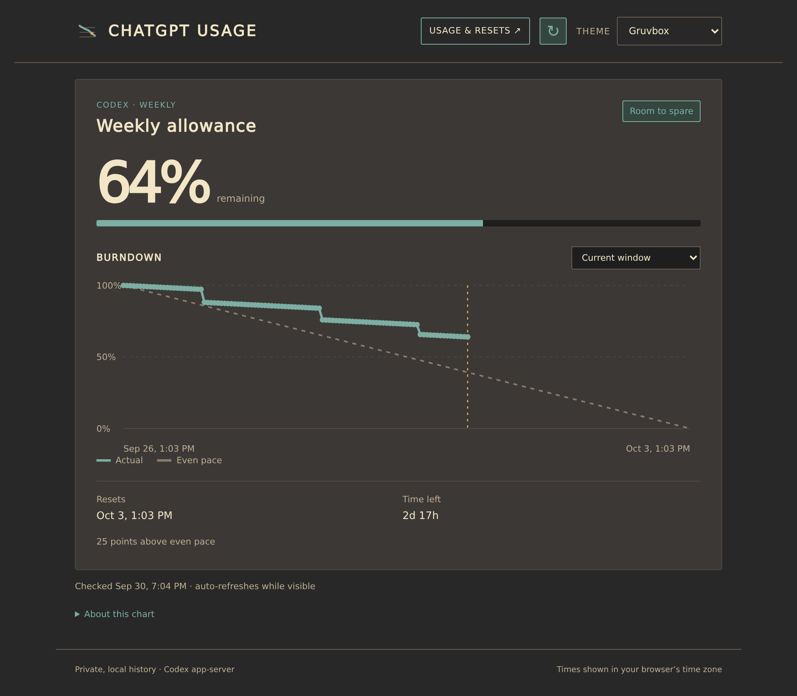
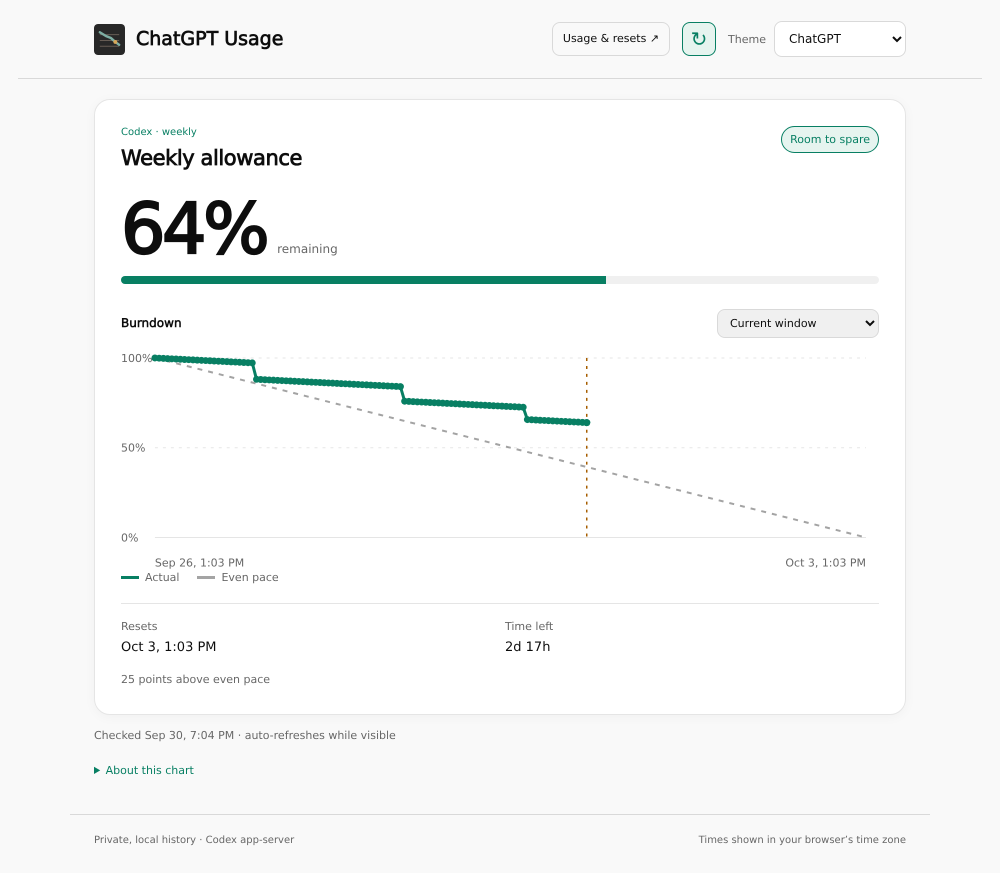
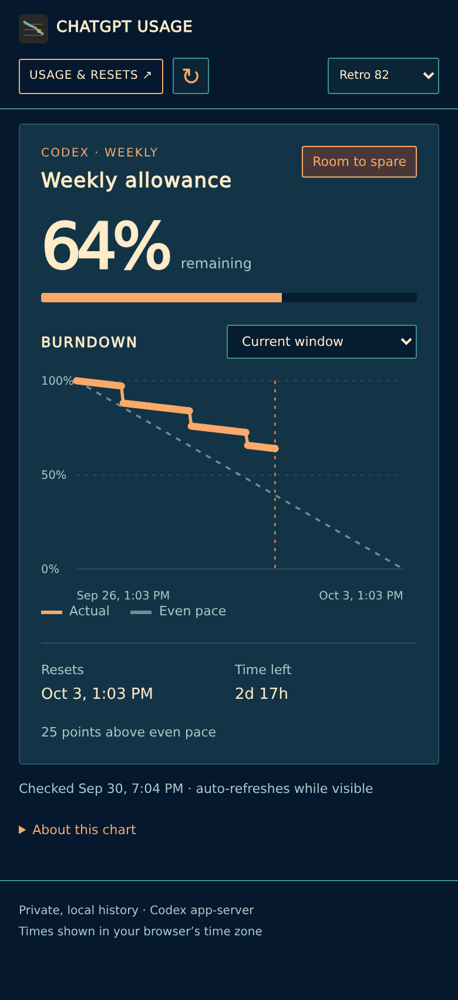

# ChatGPT Usage

A local dashboard for your Codex allowance: weekly quota remaining, reset time, usage history, and an even-pace guide. It reads the limits reported by Codex app-server using your existing ChatGPT login and stores snapshots in SQLite. It also ingests local Codex sessions for a partial model and daily token breakdown, with free auto-review usage shown separately.



*Screenshots use synthetic data. No real account information is shown.*

The dashboard refreshes when opened, when you return to the tab, and every minute while visible. Automatic checks reuse a result from the past minute; the Refresh button requests a new sample. Browse earlier weeks using the chart selector. Choose any of the 22 default themes shipped in Omarchy v4.0.4 or a ChatGPT-inspired light theme; your choice is saved in your browser. Gruvbox is the default. See the [theme palette sources and full list](docs/themes.md).

<details>
<summary>Light theme and mobile screenshots</summary>





</details>

## Quick start with mini-cloud

The easiest way to run this app is [mini-cloud](https://github.com/edofic/mini-cloud), which handles authenticated access, starts the dashboard on demand, and collects usage every ten minutes even while the web process is idle. Follow its [setup guide](https://github.com/edofic/mini-cloud/blob/main/docs/guide.md) first.

Requirements:

- Linux or macOS, Python 3.10 or later, and the [Codex CLI](https://developers.openai.com/codex/cli/). The app uses only Python's standard library.
- A ChatGPT login in Codex (`codex login`) for the **same OS user and home directory** that run mini-cloud. An API-key login does not supply ChatGPT plan allowance.
- Python on the mini-cloud service's `PATH`. On NixOS, include `pkgs.python3` in `services.mini-cloud.runtimePackages`.

1. Clone this repository into a `chatgpt-usage` directory directly under your mini-cloud `apps_dir`. For example, with `/mnt/share/apps` as your apps root:

   ```sh
   git clone https://github.com/edofic/chatgpt-usage.git /mnt/share/apps/chatgpt-usage
   cd /mnt/share/apps/chatgpt-usage
   cp .env.example .env
   ```

2. Find the Codex executable in the login shell where it works:

   ```sh
   command -v codex
   ```

   Set `CODEX_BIN` in `.env` to that absolute path. A systemd or launchd service may have a different `PATH` from your shell. The default `CODEX_BIN=codex` works when Codex is already on the **service's** `PATH`. mini-cloud loads `.env` for both the web process and the scheduled collector; it is ignored by Git.

3. Open the app through your mini-cloud app index or `chatgpt-usage.<base_domain>`. The included manifest requires authentication and membership of the `admin` group. Adjust `access_groups` for your configured identity provider. Keep authenticated access when serving the app remotely.

The first browser visit requests a sample immediately. The manifest's cron job then collects every ten minutes, and the web process stops after five idle minutes. For deployment details, see mini-cloud's [application manifest reference](https://github.com/edofic/mini-cloud/blob/main/docs/application-manifest.md) and [NixOS guide](https://github.com/edofic/mini-cloud/blob/main/docs/nixos.md).

## Run locally

From the repository root, with Codex logged in and available on your shell's `PATH`:

```sh
python3 app.py collect
PORT=8000 python3 app.py serve
```

Open <http://127.0.0.1:8000>. Browser refreshes collect new samples; for history while the browser is closed, schedule `python3 app.py collect` every ten minutes with cron or a systemd timer. Use absolute paths and the same logged-in user for scheduled jobs.

The standalone server binds only to loopback and has no built-in authentication. Use an authenticated reverse proxy, such as mini-cloud, for remote access.

| Variable | Default | Purpose |
| --- | --- | --- |
| `CODEX_BIN` | `codex` | Codex executable name or absolute path. |
| `CODEX_SESSIONS_ROOT` | `$CODEX_HOME/sessions`, otherwise `~/.codex/sessions` | Local session JSONL directory, read only. Set an absolute path if the service has a different home. |
| `DATABASE_PATH` | `data/usage.sqlite` beside `app.py` | SQLite history database; its parent directory is created automatically. |
| `PORT` | `8000` | Local HTTP port; mini-cloud supplies its assigned port. |

`app.py` reads environment variables directly; it does not load `.env` itself. For example, outside mini-cloud:

```sh
CODEX_BIN=/absolute/path/to/codex python3 app.py collect
CODEX_BIN=/absolute/path/to/codex PORT=8000 python3 app.py serve
```

## Try synthetic data

No Codex installation or login is needed to preview the dashboard:

```sh
python3 scripts/demo.py
```

Open <http://127.0.0.1:8000>. The demo creates a temporary database with a current week and a previous week, and serves the real dashboard. Refreshes remain synthetic, and your real usage database is untouched. Stop with Ctrl-C to remove the temporary data. Use `PORT=8001 python3 scripts/demo.py` if port 8000 is already occupied.

## Data and limits

The collector calls [`account/rateLimits/read`](https://learn.chatgpt.com/docs/app-server). This dashboard shows Codex allowance reported by that endpoint; it does not track every ChatGPT message limit. The web view focuses on the weekly quota, while the collector also retains other reported windows, including five-hour limits.

Quota history stores account identifiers, bucket metadata, percentages, and timestamps. Local history stores token counters, model/provider names, event dates, hashed identifiers for deduplication, and file checkpoints. No conversation text, tool content, credentials, raw logs, or raw RPC replies are stored or printed. The database, SQLite sidecar files, and environment files are ignored by Git; mini-cloud also ignores `data/` when watching for changes. History is retained until you delete it. Stop the app and collector before deleting the database and its sidecar files.

The window selector groups small reset-time variations and moving reset estimates while an allowance is unused into one observed window. Raw timestamps remain stored, and the chart includes idle samples before activity anchors the window's start.

The even-pace line runs from 100% remaining at the inferred window start to 0% at reset, staying at 100% during any preceding idle period. It is a planning reference and does not account for changing allowance, rolling windows, or resets between samples. Bursts between samples may be missed. Failed collection records a status code and leaves previous samples visible; a manual collector run exits nonzero on failure.

## Local model activity

**LOCAL MACHINE sessions only.** The model panel shows 7-day, 30-day, or all-history token totals and daily model rows, grouped by UTC day. Account-wide allowance remains authoritative across all devices. Local logs can span accounts or providers and are not joined to the currently logged-in account. They cannot exactly allocate subscription quota burn to models; no API price or cost equivalence is assumed. `codex-auto-review` models are free and excluded from the main totals, with their own expandable breakdown. Unknown models remain explicitly unknown.

`collect` ingests sessions independently of whether the account RPC succeeds. It runs through the existing cron and browser refresh path. GET requests only read SQLite. Files are discovered on collection, unchanged files are skipped, and appended bytes resume from durable offsets. The first backfill gets eight seconds per run; remaining files continue on subsequent checks. Browser automatic refreshes throttle scans to once per minute. A partial trailing JSONL line is retried later. Missing/unreadable directories or files leave previous history visible and report coverage status. Deleted or archived source files do not erase already ingested history; the default root does not discover `archived_sessions` or other devices.

For an offline backfill without invoking Codex or checking account allowance:

```sh
python3 app.py ingest
```

Repeat while the status is `backfilling`, or let scheduled collection continue it. The local status reports the observed event date range, file count, scan time, and pending/unreadable files. `CODEX_SESSIONS_ROOT` can select a different local root; previously ingested events remain retained and deduplicated.

Ingestion uses the internal rollout format, so future Codex changes may require updates:

- Newer logs have `token_usage_record` entries with response IDs and per-response counters. IDs deduplicate copied/resumed/forked history. After the first such record in a file, `token_count` mirrors are ignored: observed mirrors can lag or use different cumulative baselines.
- Older `event_msg/token_count` snapshots contribute only matching cumulative deltas and `last_token_usage`, never repeated cumulative totals. The first snapshot contributes at most its last response. A reset counts only when the new total equals that last response. Ambiguous gaps are skipped and reported as ingestion notices. Snapshot timestamps and counters form global deduplication fingerprints for copied history.
- The first session metadata identifies a rollout; embedded parent metadata in forks does not replace it. Inherited usage predating a fork is skipped. Models follow `turn_context`; response records with a mismatched turn are attributed to `unknown`. Models are logged context labels, not server billing attribution or proof against unlogged model rerouting.
- Total tokens are **input + output**. Cached/cache-write input are subsets of input, and reasoning is a subset of output. They are displayed separately without adding them to the total again.

Checkpoints tolerate truncation/replacement and replay with event deduplication. Rollouts are expected to be append-only: arbitrary edits in the middle of a growing file are not fully detected. Unsupported, malformed, oversized, or incomplete usage records are skipped conservatively. Such gaps, missing logs, and activity elsewhere mean these totals may undercount. Logs need only be readable; this app never modifies them. Private database state remains under ignored `data/` and is excluded from mini-cloud restart watching.

Run the stdlib tests with the existing Python runtime (on NixOS, `nix shell nixpkgs#python3` if needed):

```sh
python3 -m unittest discover -s tests -v
```

The synthetic demo also includes model/day and auto-review rows, and never scans real session logs.

## License

Copyright 2026 Andraz Bajt. Licensed under the [Apache License 2.0](LICENSE).
